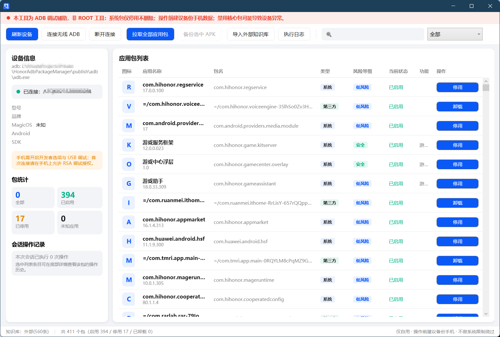
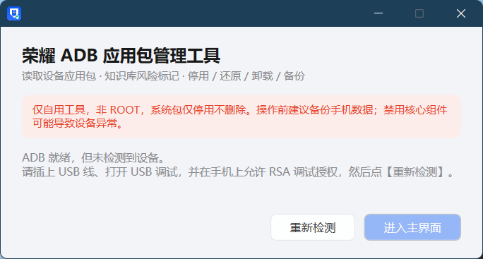
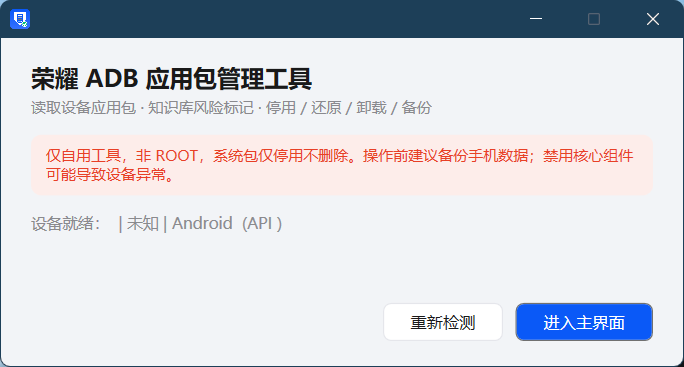
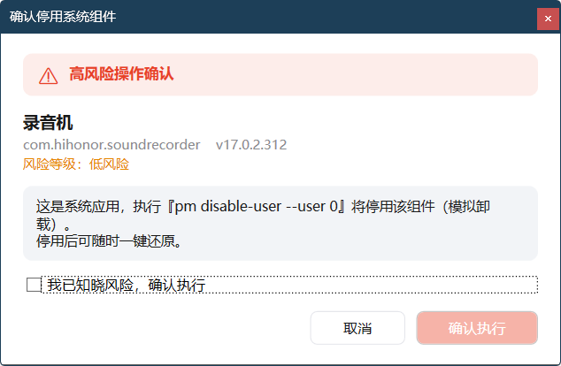
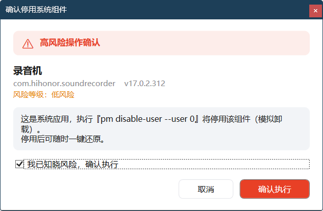
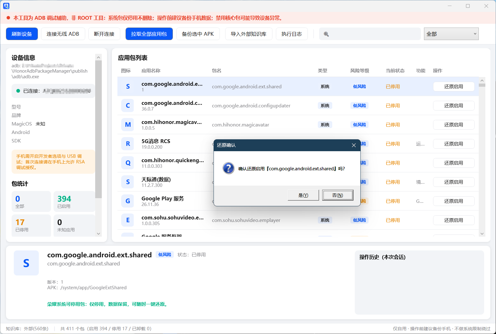

# 荣耀 ADB 应用包管理工具（HonorAdbPackageManager）

    

**免 ROOT 管理荣耀 MagicOS 手机的应用包**：读取全部应用包名，自动匹配内置知识库显示中文名称、功能说明与风险等级；系统包一键停用 / 还原，第三方包卸载，核心组件智能拦截，APK 一键备份。

> ⚠️ **使用前必读**：本工具为 ADB 调试辅助，**非 ROOT 工具**。系统包仅停用不删除；操作前建议备份手机数据；禁用核心组件可能导致设备异常（工具已默认拦截）。

---

## ✨ 主界面一览



- **顶部工具栏**：刷新设备 / 无线 ADB / 拉取全部应用包 / 备份 APK / 导入知识库 / 执行日志 / 实时搜索 + 类型筛选
- **左侧面板**：设备信息（型号 / MagicOS / Android / SDK）、包统计（全部 / 已启用 / 已停用 / 未知）、会话操作记录
- **中间列表**：图标 / 应用名称 / 包名 / 类型 / 风险等级 / 当前状态 / 功能说明 / 操作按钮，支持点击列头排序、逐列分割线
- **底部详情**：选中包的版本、APK 路径、风险说明与会话内操作历史
- **常驻红条**：仅自用警示，永不消失

---

## 🖼️ 功能流程截图

### 1. 启动与设备检测

程序启动后自动检测 `adb\adb.exe` 与连接的设备。手机开启 USB 调试并插线后，在手机上允许 RSA 调试授权，点【重新检测】即可。

| 未连接设备 | 设备就绪 |
| :---: | :---: |
|  |  |

检测到多台设备时会弹出选择窗口；也支持【连接无线 ADB】输入 `IP:端口` 走 Wi-Fi 连接。

### 2. 操作前风险确认（防止误操作）

点击【停用】/【卸载】会弹出风险确认弹窗：展示包名、版本、风险等级与将执行的具体 `pm` 命令。**必须手动勾选「我已知晓风险」后，确认按钮才可用**；确认后还有一次「最终确认」Yes/No 弹窗，双保险防手滑。

| 未勾选：按钮灰化 | 已勾选：允许执行 |
| :---: | :---: |
|  |  |

### 3. 停用管理 / 一键还原

停用后的包状态变为「已停用」，按钮切换为【还原启用】，点击后二次确认即可通过 `pm enable` 恢复。选中任意条目，底部详情面板会显示该包的版本、APK 路径与本次会话的操作历史。



---

## 🧩 核心特性

| 特性 | 说明 |
| --- | --- |
| 📦 全量包读取 | `pm list packages -f / -s / -3 / -d` 四路合并 + `dumpsys` 4 线程并发解析，400+ 包约 30 秒 |
| 🧠 内置知识库 | **560 条**中文说明：荣耀 `com.hihonor.*` 154 条、华为遗留 `com.huawei.*` 296 条、AOSP/GMS 110 条 |
| 🏷️ 三类包分级 | 第三方（可卸载）/ 系统可停用（disable-user）/ 核心系统（禁止操作，按钮灰化） |
| 🚦 四级风险标记 | 安全 / 低风险 / 高风险 / 禁止操作，色块徽章一眼可辨 |
| ❓ 未知应用保护 | 知识库未收录的包标记「未知应用」，操作前强制高危二次确认 |
| 💾 APK 备份 | `adb pull` 拉取到 `Backup\{设备序列号}\`，卸载前先备份 |
| 📶 无线 ADB | 输入 `IP:端口` 免线连接 |
| 📜 实时日志 | 所有 ADB 命令与 stdout/stderr 实时输出，可导出 TXT |
| 🔍 搜索筛选 | 包名 / 应用名 / 描述实时过滤 + 类型筛选 + 列头点击排序 |
| 🖥️ 免安装运行 | 自包含发布：**目标电脑无需安装 .NET**，解压即用（ADB 已内置） |

---

## ⚙️ 工作原理（ADB 命令映射）

本工具不修改系统分区、不做绕过，全部操作通过 ADB 官方接口完成：

| 界面操作 | 执行命令 | 适用对象 | 可否恢复 |
| --- | --- | --- | --- |
| 卸载 | `pm uninstall -k --user 0 <包名>` | 第三方应用 | 需原 APK 重装 |
| 停用 | `pm disable-user --user 0 <包名>` | 系统可停用包 | ✅ `pm enable` 一键还原 |
| 还原 | `pm enable <包名>` | 已停用包 | — |
| 备份 | `adb pull <apk路径>` | 全部包 | — |

**成功判定兼容**：老系统返回 `Success`，Android 12+ 返回 `Package xxx new state: disabled-user`，工具对两种回执均正确识别。

**荣耀 SPC 系统保护**：新版 MagicOS 会拒绝部分系统包的 disable 请求（返回 Permission Denial / SecurityException），属于系统限制，工具如实反馈失败原因，**不做任何绕过**。

---

## 🚀 快速开始

### 环境要求

- Windows 10 / 11（x64）
- 荣耀 / 华为手机（MagicOS / EMUI），其他 AOSP 机型亦可使用（未知包走二次确认）
- USB 数据线或同一 Wi-Fi（无线模式）

### 使用步骤

1. 解压发行包到任意目录（**免安装，无需 .NET 环境**）
2. 双击 `HonorAdbPackageManager.exe`
3. 手机：设置 → 关于手机 → 连点版本号 7 次开启开发者选项 → 打开 **USB 调试**
4. 插上 USB 线，手机弹出『允许 USB 调试』点**允许**
5. 程序中点【重新检测】→ 设备就绪后点【进入主界面】
6. 点【拉取全部应用包】，等待列表加载完成
7. 搜索或筛选目标包 → 点击【停用】/【卸载】→ 按提示确认

> 💡 建议流程：**先备份 APK → 再停用观察 1-2 天 → 无异常后保持停用**。停用可随时还原，是比卸载更安全的选择。

---

## 🗂️ 目录结构

```
HonorAdbPackageManager/
├─ HonorAdbPackageManager.exe   # 主程序（自包含运行时，免安装）
├─ adb/                         # ADB 组件（platform-tools 37.0.1）
│  ├─ adb.exe
│  ├─ AdbWinApi.dll
│  └─ AdbWinUsbApi.dll
├─ Data/
│  └─ HonorPackageDb.json       # 内置知识库（可自行编辑，重启生效）
├─ Assets/                      # 应用图标资源
├─ Cache/icons/                 # 图标缓存（可随时清空）
├─ Backup/{设备序列号}/          # APK 备份目录
└─ Logs/                        # 导出的日志 TXT
```

---

## 📚 知识库

内置 `Data/HonorPackageDb.json`，当前 **560 条**：

- **数据来源**：[UAD-NG (Universal Android Debloater)](https://github.com/Universal-Debloater-Alliance/universal-android-debloater-next-generation) 社区包数据库（huawei→hihonor 命名映射）、CSDN《MagicOS 内置应用注释》、荣耀俱乐部公开资料，人工翻译整理为中文
- **字段**：包名、中文名称、功能描述、风险等级（安全/低风险/高风险/禁止操作）、是否允许停用、备注
- **自定义**：直接编辑 JSON 后重启程序，或使用界面【导入外部知识库】合并外部 JSON（同键覆盖）

示例条目：

```json
"com.hihonor.game.kitserver": {
  "Name": "游戏服务框架",
  "Desc": "游戏工具箱服务端：悬浮窗、按键映射、防误触",
  "Risk": "安全",
  "CanDisable": true
},
"com.hihonor.phone": {
  "Name": "电话",
  "Desc": "拨号与通话核心组件",
  "Risk": "禁止操作",
  "CanDisable": false
}
```

---

## 🛠️ 从源码构建

```bash
# 需要 .NET 10 SDK (10.0.4xx)
git clone <仓库地址>
cd HonorAdbPackageManager
dotnet build HonorAdbPackageManager/HonorAdbPackageManager.csproj -c Release

# 发布自包含单目录（目标机免装 .NET）
dotnet publish HonorAdbPackageManager/HonorAdbPackageManager.csproj \
  -c Release -r win-x64 --self-contained true -o publish
```

技术栈：.NET 10 / WPF / MVVM / 全异步 ADB（Task + Dispatcher）/ 高 DPI（PerMonitorV2）

---

## ❓ FAQ

**Q：停用失败，提示 Permission Denial？**
荣耀新版 MagicOS 的 SPC 保护拒绝了对该包的停用请求，属系统限制。工具不做绕过，请选择其他包操作。

**Q：停用后手机哪里异常了怎么办？**
在列表中筛选「已停用」，找到对应包点【还原启用】即可恢复；所有停用操作均可用此方式撤销。

**Q：卸载和停用有什么区别？**
停用：数据保留，随时一键还原，**推荐**。卸载（第三方包）：应用与数据从当前用户移除，需原 APK 才能重装。

**Q：功能说明列是空的？**
该包未收录在知识库中（显示「未知应用」标记）。可在知识库 JSON 中手动补充，或通过界面导入。

**Q：支持其他品牌手机吗？**
支持任何开启 USB 调试的安卓设备；小米/OPPO/vivo 等品牌的包名说明不在内置知识库中，会以未知应用形式呈现（操作前强制二次确认）。

---

## 📄 免责声明

- 本工具仅供个人学习与设备管理使用，**免费且不内置任何广告**
- 不含 ROOT、解锁、绕过系统限制等功能
- 对系统包的一切操作请先备份；因使用本工具导致的任何数据丢失或设备异常，由使用者自行承担
- 请勿在他人设备上未经允许使用本工具

---

*Made with 🔵 by HonorAdbPackageManager · .NET 10 WPF · platform-tools 37.0.1*
