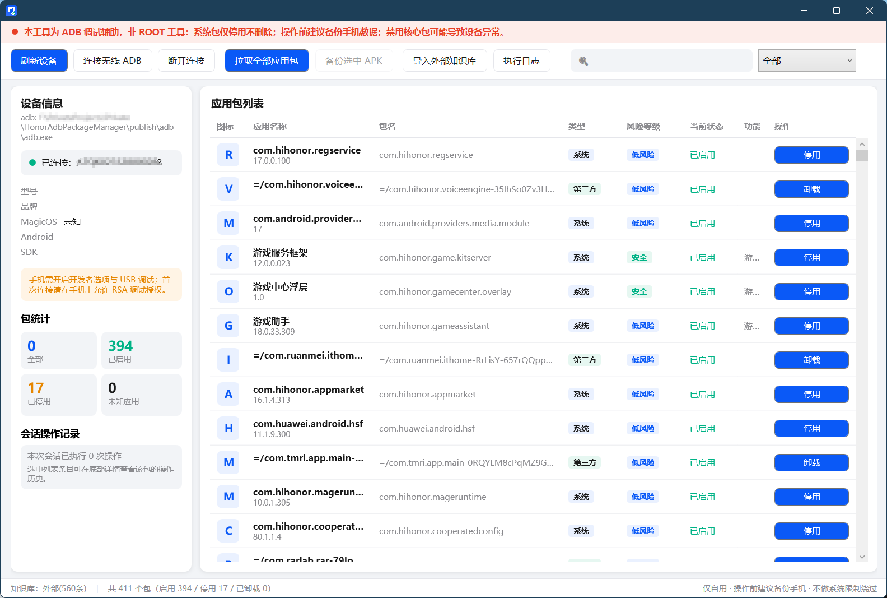
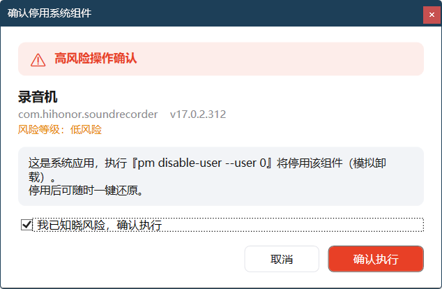

# HonorAdbPackageManager v1.0.0

**免 ROOT 管理荣耀 MagicOS 手机的应用包** —— 读取全部应用包名，自动匹配内置中文知识库（名称/功能/风险），系统包一键停用还原、第三方包卸载、核心组件智能拦截、APK 一键备份。

[](#) [](#) [](#) [](#)

---

## 📥 下载

| 文件 | 说明 |
| --- | --- |
| `HonorAdbPackageManager-v1.0.0.zip` (67.2 MB) | 完整发行包：自包含 .NET 10 运行时 + 内置 ADB，**解压即用** |

**SHA256**：`65BDCCDFA4721EF57EE5C4CF9C54A231372FCD85F7FB10574A03AD083E8D0AD5`

> 系统要求：Windows 10 (1709+) / Windows 11，x64。**无需安装 .NET**，无需安装 ADB，全部内置。

---

## ✨ 功能亮点

### 📦 应用包管理
- **全量包读取**：`pm list packages` + `dumpsys` 4 线程并发解析，400+ 包约 30 秒加载完成
- **三类包分级**：第三方应用（可卸载）/ 系统可停用包（disable-user）/ 核心系统包（禁止操作）
- **一键停用 / 还原**：系统包 `pm disable-user` 停用（数据保留），`pm enable` 随时还原
- **第三方包卸载**：`pm uninstall -k --user 0`，支持从本地备份 APK 重装
- **APK 备份**：`adb pull` 拉取到 `Backup\{设备序列号}\`，卸载前先留后悔药

### 🧠 内置中文知识库（560 条）
- 荣耀 `com.hihonor.*` 全系列 **154 条**（MagicOS 8/9/10/11 实机验证）
- 华为遗留 `com.huawei.*` **296 条**（Magic5 Pro 等双品牌过渡机型覆盖）
- AOSP / GMS 基础包 **110 条**
- 每条包含：中文名称、功能描述、风险等级、是否允许停用、备注
- 支持界面导入外部 JSON 合并，或直接编辑 `Data\HonorPackageDb.json`

### 🚦 风险控制
- **四级风险标记**：安全 / 低风险 / 高风险 / 禁止操作，彩色徽章直观展示
- **核心包智能拦截**：电话、桌面、相机、指纹等禁用会导致设备异常的组件，按钮直接灰化
- **双重确认防误触**：勾选式风险确认（「我已知晓风险」）+ 最终确认弹窗
- **未知应用保护**：知识库未收录的包强制高危二次确认

### 🛠️ 工具能力
- **实时日志窗口**：所有 ADB 命令与 stdout/stderr 实时输出，可导出 TXT
- **无线 ADB**：输入 `IP:端口` 免线连接
- **多设备支持**：多台设备弹窗选择
- **搜索与筛选**：包名/应用名/描述实时过滤 + 类型筛选 + 列头点击排序
- **高 DPI**：PerMonitorV2 适配，4K/缩放屏幕不模糊

### 🖥️ 界面
- 鸿蒙工具箱风格：卡片布局、蓝色主题、风险色块
- 常驻安全警示条
- 底部详情面板：版本、APK 路径、会话操作历史
- 自绘应用图标（盾牌 + 应用列表 + 对勾）

---

## 📸 截图

| 主界面 | 风险确认 |
| --- | --- |
|  |  |

> 更多截图见仓库 `screenshots/` 目录。

---

## 🚀 快速开始

1. **下载** 并解压 `HonorAdbPackageManager-v1.0.0.zip` 到任意目录
2. 手机开启 **USB 调试**（设置 → 关于手机 → 连点版本号 7 次 → 开发者选项 → USB 调试）
3. 插上 USB 线，手机弹出『允许 USB 调试』点**允许**
4. 双击 `HonorAdbPackageManager.exe` → 【重新检测】→ 【进入主界面】
5. 点【拉取全部应用包】，搜索或筛选目标包，点击【停用】/【卸载】按提示确认

> 💡 **推荐流程**：先【备份选中 APK】→ 停用观察 1-2 天 → 无异常后保持停用。停用可随时一键还原，比卸载安全得多。

---

## ⌨️ ADB 命令映射

| 界面操作 | 实际命令 | 可否恢复 |
| --- | --- | --- |
| 卸载（第三方） | `pm uninstall -k --user 0 <包名>` | 需原 APK 重装 |
| 停用（系统包） | `pm disable-user --user 0 <包名>` | ✅ `pm enable` 一键还原 |
| 还原启用 | `pm enable <包名>` | — |
| 备份 APK | `adb pull <apk路径>` | — |

**兼容性说明**：
- 成功回执同时兼容 `Success`（旧系统）与 `Package xxx new state: disabled-user`（Android 12+）两种格式
- 荣耀新版 MagicOS 的 **SPC 系统保护**会拒绝部分系统包的停用请求，工具如实反馈失败原因，**不做任何绕过**

---

## 📂 目录结构

```
HonorAdbPackageManager/
├─ HonorAdbPackageManager.exe   # 主程序（自包含运行时）
├─ adb/                         # platform-tools 37.0.1
├─ Data/HonorPackageDb.json     # 知识库（可编辑，重启生效）
├─ Assets/                      # 图标资源
├─ Cache/icons/                 # 图标缓存（可清空）
├─ Backup/{序列号}/              # APK 备份
└─ Logs/                        # 导出日志
```

---

## 🛠️ 从源码构建

```bash
git clone https://github.com/HaoDaYiGuoFan/HonorAdbPackageManager.git
cd HonorAdbPackageManager
dotnet publish HonorAdbPackageManager/HonorAdbPackageManager.csproj \
  -c Release -r win-x64 --self-contained true -o publish
```

技术栈：.NET 10 / WPF / MVVM / 全异步 ADB / 高 DPI（PerMonitorV2）

---

## 📋 v1.0.0 更新日志

### 新增
- 全量应用包读取与中文知识库自动匹配（560 条）
- 系统包停用 / 还原、第三方包卸载、核心包拦截
- APK 单文件备份、无线 ADB、多设备选择
- 风险确认弹窗（勾选式 + 最终确认双重防护）
- 实时 ADB 命令日志与导出
- 列表搜索、类型筛选、列头排序、列分割线
- 自绘应用 Logo（窗口图标 + exe 图标）

### 修复
- Android 12+ 设备 `pm disable-user` 成功回执（`new state: disabled-user`）被误判为失败的问题

### 已知限制
- 图标提取采用「选中时按需 pull APK」策略，部分 Adaptive Icon 无法解析时显示首字母占位
- MagicOS SPC 保护的包无法停用（系统限制，不绕过）
- 包状态仅会话内保存，关闭程序后需重新拉取

---

## ❓ FAQ

**Q：停用失败提示 Permission Denial？**
荣耀 SPC 系统保护拒绝该操作，属正常限制，选择其他包即可。

**Q：停用后想恢复？**
列表筛选「已停用」→ 找到包点【还原启用】。

**Q：功能说明列是空的？**
该包未收录知识库（显示未知应用标记），可编辑 `Data\HonorPackageDb.json` 补充或通过界面导入。

**Q：支持其他品牌手机吗？**
支持任何开启 USB 调试的安卓设备；非荣耀/华为品牌的包名说明不在知识库中，以未知应用形式呈现。

---

## 📄 免责声明

- 本工具仅供个人学习与设备管理使用，免费、无广告、无追踪
- 不含 ROOT、解锁 Bootloader、绕过系统限制等任何功能
- 操作系统应用前请自行备份数据；因使用本工具导致的任何数据丢失或设备异常由使用者自行承担
- 请勿在未经他人允许的情况下在其设备上使用本工具

---

**Full Changelog**: https://github.com/HaoDaYiGuoFan/HonorAdbPackageManager/commits/master
