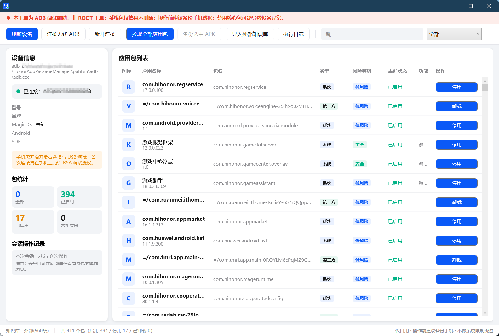
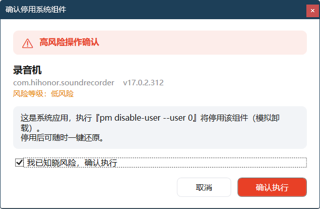
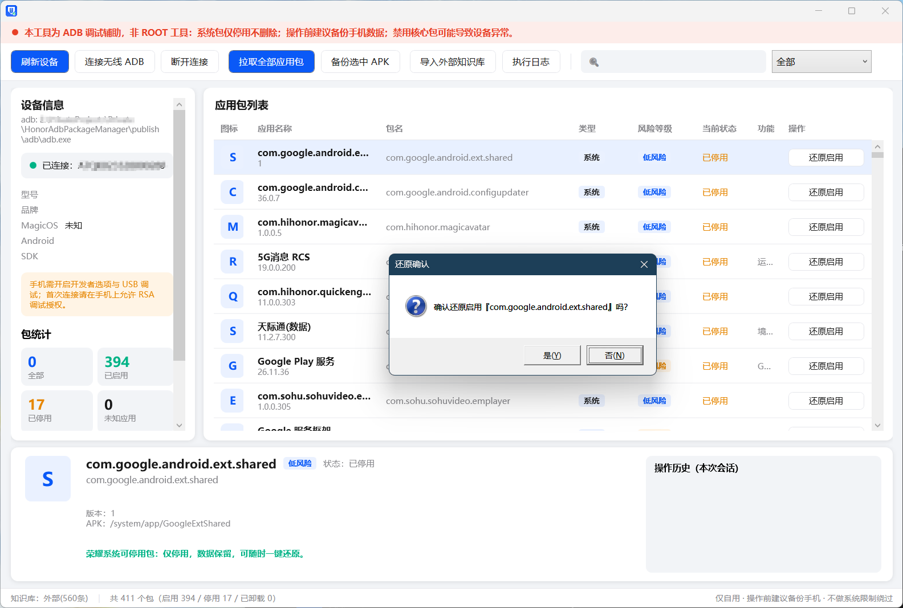

# HonorAdbPackageManager v1.1.0

**免 ROOT 管理荣耀 MagicOS 手机的应用包** —— 读取全部应用包名，自动匹配内置中文知识库（名称/功能/风险），系统包一键停用还原、第三方包卸载、核心组件智能拦截、APK 一键备份。

[](#) [](#) [](#) [](#) [](#)

> ⚠️ 本工具为 ADB 调试辅助，**非 ROOT 工具**。系统包仅停用不删除；操作前建议备份手机数据。

---

## 📥 下载

| 文件 | 说明 |
| --- | --- |
| `HonorAdbPackageManager-v1.1.0.zip` (67.2 MB) | 自包含发行包：内置 .NET 10 运行时 + ADB 37.0.1 + 知识库 1139 条，**解压即用，目标机无需安装任何依赖** |

**SHA256**：`5F9030CE144120998BC4F68EEA950B2C8DC41C4CA2C73121B24FC230470FE1D6`

系统要求：Windows 10 (1709+) / Windows 11 x64。

---

## 🆕 v1.1.0 更新内容

### 知识库大扩充（560 → 1139 条）

- **真机驱动补全**：在荣耀 Magic5 Pro（MagicOS 11）上实测 412 个包，**匹配率 100%**
- 荣耀 `com.hihonor.*` **351 条**（含 MagicOS 11 新增：应用市场/图库/控制中心/Magic Brain/视觉引擎等）
- 华为遗留 `com.huawei.*` **296 条**（双品牌过渡机型全覆盖，含反向镜像）
- 荣耀 `com.honor.*` 旧前缀 **68 条**
- **第三方应用 251 条**：国内主流（微信/QQ/淘宝/京东/拼多多/抖音/小红书/B站/美团/银行/航旅/AI 助手等）+ 国际 Top100（Google 全家桶/Meta/X/TikTok/Telegram/Netflix/Spotify/Adobe/Microsoft/ChatGPT/主流游戏等）
- AOSP 系统 + Google 服务 + 高通底层 **173 条**（含 APEX 模块、overlay 资源包、CDMA/IMS 组件）

### 🐛 关键修复

- **包名解析 Bug（重要）**：Android 13+ 的 APK 路径含 base64 目录名（`~~xxx==/pkg-yyy==/base.apk`），旧版用第一个 `=` 分割导致 318 个包的包名被污染 → 知识库匹配失败、图标提取失败、**APK 备份对系统包全部失败**。已改用最后一个 `=` 分割，彻底修复
- 停用/还原成功回执兼容 Android 12+ 的 `Package xxx new state: disabled-user` 格式（v1.0 已修，随版说明）

### ✨ 界面增强（v1.0 → v1.1 累计）

- 新增**「知识库条目」列**：直接显示 HonorPackageDb.json 中的 Name + Description 双行文本，未收录的包明确标注「未收录」（灰斜体）
- 原「功能说明」列改为显示 Remark（荣耀专属提示/未知标记），与知识库列分工明确
- 列头点击排序、列分割线
- 双重确认防误触：勾选式风险确认 + 最终确认弹窗
- 自绘应用 Logo（窗口 + exe 图标）、渐变主题 UI 美化

---

## ✨ 功能总览

### 📦 应用包管理
- **全量包读取**：`pm list packages` 四路合并 + `dumpsys` 4 线程并发解析，400+ 包约 30 秒
- **三类包分级**：第三方应用（可卸载）/ 系统可停用包（disable-user）/ 核心系统包（禁止操作，按钮灰化）
- **停用 / 还原**：系统包 `pm disable-user`（数据保留），`pm enable` 一键还原
- **第三方包卸载**：`pm uninstall -k --user 0`，支持从备份重装
- **APK 备份**：`adb pull` 拉取到 `Backup\{设备序列号}\`

### 🧠 中文知识库（1139 条）

| 分类 | 条数 | 覆盖 |
| --- | --- | --- |
| 荣耀 hihonor | 351 | MagicOS 8/9/10/11 系统组件 + 智慧服务 |
| 华为遗留 huawei | 296 | 双品牌过渡机型组件 |
| 荣耀旧前缀 honor | 68 | 旧版系统兼容 |
| AOSP 系统 + Google | 163 | 系统框架 / APEX / GMS / 高通底层 |
| 第三方应用 | 251 | 国内主流 + 国际 Top100 |

每条含：中文名称、功能描述、风险等级、是否允许停用、备注。支持编辑 JSON 或界面导入扩展。

### 🚦 风险控制
- 四级风险标记：安全 / 低风险 / 高风险 / 禁止操作（色块徽章）
- 核心包智能拦截（电话/桌面/相机/SystemUI/媒体库等）
- 未知应用强制高危二次确认
- 不做任何系统限制绕过，SPC 保护如实反馈

### 🛠️ 工具能力
- 实时 ADB 命令日志（可导出 TXT）
- 无线 ADB、多设备选择
- 搜索 / 类型筛选 / 列排序 / 知识库列
- 高 DPI（PerMonitorV2）、自包含免安装

---

## 📸 截图

| 主界面 | 风险确认 | 停用与还原 |
| --- | --- | --- |
|  |  |  |

---

## 🚀 快速开始

1. 解压发行包到任意目录（免安装、无需 .NET）
2. 手机开启 USB 调试并连接，允许 RSA 授权
3. 双击 `HonorAdbPackageManager.exe` → 【重新检测】→ 【进入主界面】
4. 【拉取全部应用包】→ 搜索/筛选 → 【停用】/【卸载】按提示确认

> 💡 推荐流程：**先备份 APK → 停用观察 1-2 天 → 无异常保持**。停用可随时一键还原。

---

## ⌨️ ADB 命令映射

| 界面操作 | 实际命令 | 可否恢复 |
| --- | --- | --- |
| 卸载（第三方） | `pm uninstall -k --user 0 <包名>` | 需原 APK 重装 |
| 停用（系统包） | `pm disable-user --user 0 <包名>` | ✅ `pm enable` |
| 还原启用 | `pm enable <包名>` | — |
| 备份 APK | `adb pull <apk路径>` | — |

---

## 🛠️ 从源码构建

```bash
git clone https://github.com/HaoDaYiGuoFan/HonorAdbPackageManager.git
cd HonorAdbPackageManager
dotnet publish HonorAdbPackageManager/HonorAdbPackageManager.csproj \
  -c Release -r win-x64 --self-contained true -o publish
```

技术栈：.NET 10 / WPF / MVVM / 全异步 ADB / PerMonitorV2 高 DPI

---

## ❓ FAQ

**Q：停用失败提示 Permission Denial？**
荣耀 SPC 系统保护，属正常限制，工具不绕过。

**Q：停用后想恢复？**
筛选「已停用」→ 点【还原启用】。

**Q：功能说明列是空的？**
该包未收录知识库，显示「未收录」。可编辑 `Data\HonorPackageDb.json` 补充（欢迎 PR）。

**Q：支持其他品牌手机吗？**
支持任何开启 USB 调试的安卓设备；非荣耀/华为品牌的知识库覆盖有限，欢迎提交机型数据。

---

## 📄 免责声明

本工具仅供个人学习与设备管理使用，免费、无广告、无追踪；不含 ROOT、解锁、绕过系统限制功能；操作系统应用前请自行备份数据，因使用本工具导致的数据丢失或设备异常由使用者自行承担。

---

**Full Changelog**: https://github.com/HaoDaYiGuoFan/HonorAdbPackageManager/commits/master
