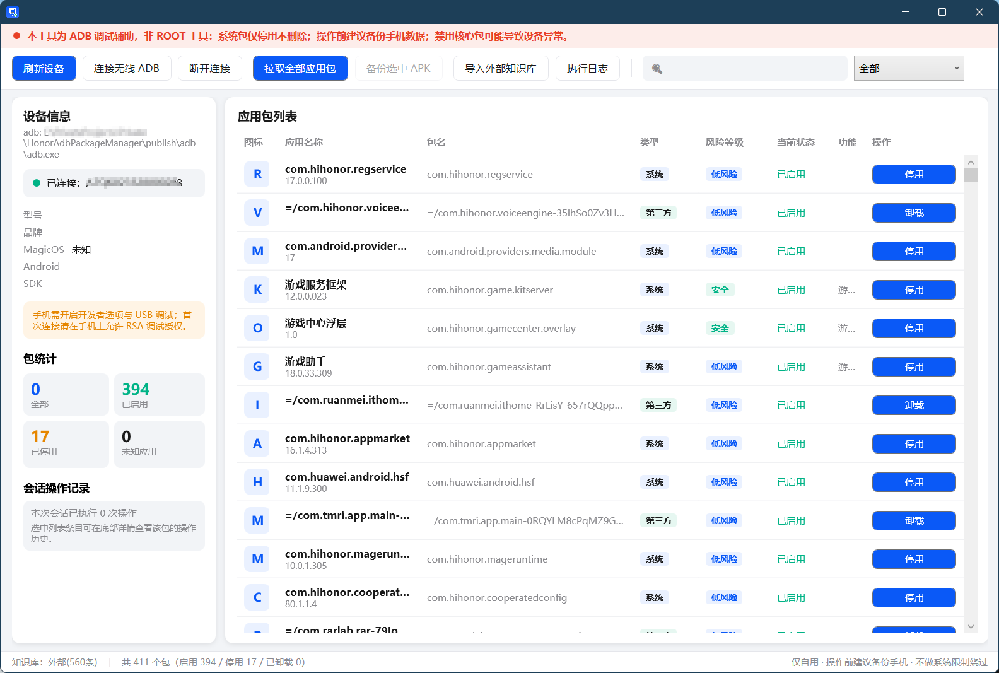
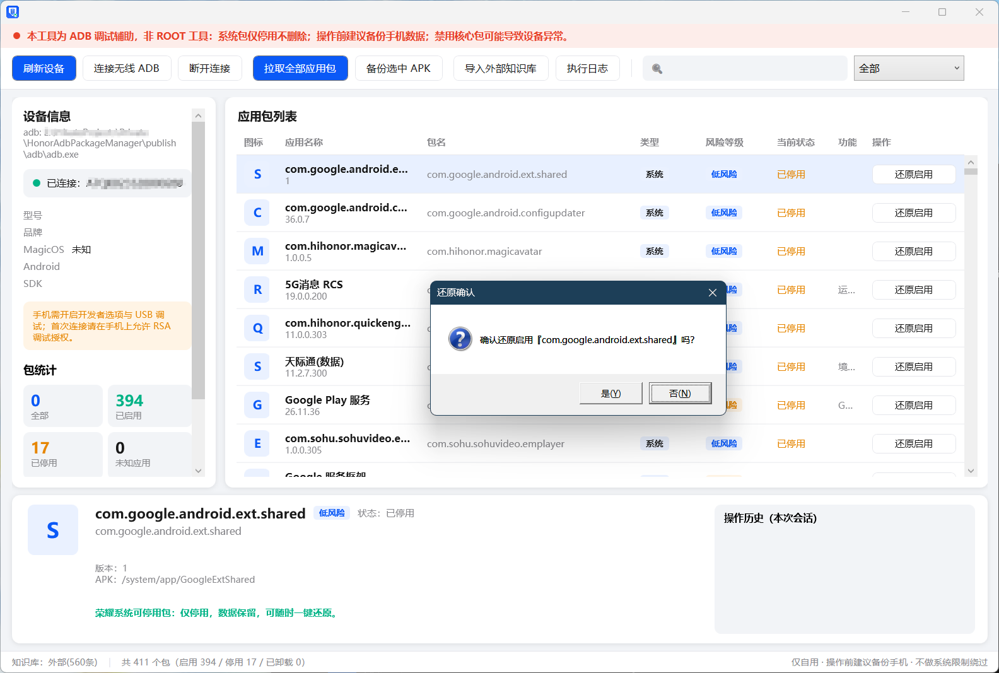
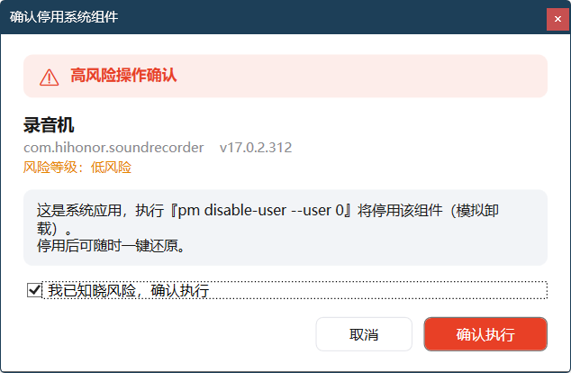

# HonorAdbPackageManager v1.3.0

**免 ROOT 管理荣耀 MagicOS 手机的应用包** —— 读取全部应用包名，自动匹配内置中文知识库（名称/功能/风险），系统包一键停用还原、第三方包卸载、核心组件智能拦截、APK 一键备份，并内置仿鸿蒙工具箱的「快速工具箱」批量操作页。

[](#) [](#) [](#) [](#) [](#)

> ⚠️ 本工具为 ADB 调试辅助，**非 ROOT 工具**。系统包仅停用不删除；操作前建议备份手机数据。

---

## 📥 下载

| 文件 | 说明 |
| --- | --- |
| `HonorAdbPackageManager-v1.3.0.zip` (67.2 MB) | 自包含发行包：内置 .NET 10 运行时 + ADB 37.0.1 + 知识库 1139 条，**解压即用，目标机无需安装任何依赖** |

**SHA256**：`3C6CD4EF6F6AFB788A1EDCD401C4E111F9229A2235927FB9E130CAB3A588B1BA`

系统要求：Windows 10 (1709+) / Windows 11 x64。

---

## 🆕 v1.3.0 更新内容（v1.2 系列 → v1.3.0）

### 🧰 快速工具箱（全新）

主界面新增第二个选项卡，参照鸿蒙工具箱的彩色卡片布局：

| 分类卡片 | 内容 |
| --- | --- |
| 荣耀全家桶 | 钱包 / 视频 / 音乐 / 阅读 / 浏览器 / 应用市场 / 运动健康 / 游戏中心 / 荣耀商城等 11 项 |
| 智慧增值服务 | 智慧搜索 / 智慧识屏 / YOYO 语音 / 负一屏 / 快应用中心 / 智慧推荐等 10 项 |
| 系统功能 | 主题 / 天气 / 杂志锁屏 / 系统更新 / 查找设备 / 备份等 10 项 |
| 专项功能 | 云空间 / 多屏协同 / 广告服务 / 讯飞引擎 / 工程菜单等 8 项 |
| 冗余服务（可一键停用） | 广告 / 日志上报 / 后台查杀 / 用户体验分析等 12 项安全预设 |

- 每个条目按包名（含备选包名自动探测）绑定主列表数据，状态实时联动：已启用→【停用/卸载】、已停用→【还原】、未安装→灰显、核心包→红色「禁止操作」
- **批量操作条**：「一键停用冗余服务」先列出全部目标包再逐个双重确认；「还原本会话所有停用」跟踪会话内操作并逐个确认还原
- **所有停用/卸载/还原均走双重确认**（勾选「我已知晓风险」→ 最终确认弹窗），每一步可取消

### 🖥️ 界面与体验

- **窗口居中**：主窗口/启动页屏幕居中，全部弹窗（风险确认/输入框/日志/设备选择）居中于父窗口——统一 `MsgBox` 帮助类自动附加 Owner + 对话框自挂 Owner 双保险
- **无线 ADB 地址记忆**：连接成功后自动保存 `IP:端口` 到 `Data\settings.json`；下次打开输入框自动预填（全选可覆盖），两条连接链路（启动页/主界面）全覆盖
- **无线 ADB 模式引导**：无数据线时启动页新增「无线 ADB 模式」按钮，弹出 6 步图文操作指引，可从弹窗直接进入连接流程
- **一键停用清单可视化**：批量操作确认弹窗列出每个目标包的名称/包名/当前状态
- **窗口标题修复**：全部窗口补齐 Title 属性，任务栏/Alt+Tab 正确显示
- 列头点击排序、列分割线、「知识库条目」双行列（Name + Description，未收录明确标注）
- 自绘应用 Logo（盾牌+列表+对勾）：窗口图标 + exe 文件图标 + 弹窗图标统一

### 🐛 关键修复

- **包名解析 Bug（v1.0 遗留，重要）**：Android 13+ 的 APK 路径含 base64 目录名（`~~xxx==/pkg-yyy==/base.apk`），旧版用第一个 `=` 分割导致 318 个包名被污染 → 知识库匹配失败、图标提取失败、APK 备份对系统包全部失败。已改用最后一个 `=` 分割
- **停用成功误报失败**：Android 12+ 的成功回执 `Package xxx new state: disabled-user` 被旧判定当失败。已兼容 `Success` / 空输出 / `new state` 三种形态

---

## 🧠 内置中文知识库（1139 条）

| 分类 | 条数 | 覆盖 |
| --- | --- | --- |
| 荣耀 hihonor | 351 | MagicOS 8/9/10/11 系统组件 + 智慧服务 |
| 华为遗留 huawei | 296 | 双品牌过渡机型（Magic5 Pro 等实测） |
| 荣耀旧前缀 honor | 68 | 旧版系统兼容 |
| AOSP 系统 + Google | 163 | 系统框架 / APEX / GMS / 高通底层 |
| 第三方应用 | 251 | 国内主流 + 国际 Top100 |

- **真机实测**：荣耀 Magic5 Pro（MagicOS 11）412 个包 **100% 匹配显示**
- 数据来源：UAD-NG 社区数据库、CSDN《MagicOS 内置应用注释》、荣耀社区公开资料，人工翻译整理
- 支持编辑 `Data\HonorPackageDb.json` 或界面导入外部 JSON 合并

---

## ✨ 功能总览

### 📦 应用包管理
- **全量包读取**：`pm list packages` 四路合并 + `dumpsys` 4 线程并发解析，400+ 包约 30 秒
- **三类包分级**：第三方应用（可卸载）/ 系统可停用包（disable-user）/ 核心系统包（禁止操作，按钮灰化）
- **停用 / 还原**：`pm disable-user` 数据保留，`pm enable` 一键还原
- **第三方包卸载**：`pm uninstall -k --user 0`
- **APK 备份**：`adb pull` 拉取到 `Backup\{设备序列号}\`
- **搜索 / 筛选 / 排序**：包名/名称/描述实时过滤 + 类型筛选 + 列头排序

### 🛠️ 工具能力
- 实时 ADB 命令日志（stdout/stderr 全量，可导出 TXT）
- 无线 ADB（地址记忆 + 启动页引导）、多设备选择
- 高 DPI（PerMonitorV2）、自包含免安装、ADB 内置

---

## 📸 截图

| 主界面 | 快速工具箱 | 风险确认 |
| --- | --- | --- |
|  |  |  |

---

## 🚀 快速开始

1. 解压发行包到任意目录（免安装、无需 .NET）
2. 手机开启 USB 调试并连接，允许 RSA 授权；或点「无线 ADB 模式」按指引连接
3. 双击 `HonorAdbPackageManager.exe` → 【重新检测】→ 【进入主界面】
4. 【拉取全部应用包】→ 在「应用管理」或「快速工具箱」中操作，按提示双重确认

> 💡 推荐流程：**先备份 APK → 停用观察 1-2 天 → 无异常保持**。停用可随时一键还原。

---

## ⌨️ ADB 命令映射

| 界面操作 | 实际命令 | 可否恢复 |
| --- | --- | --- |
| 卸载（第三方） | `pm uninstall -k --user 0 <包名>` | 需原 APK 重装 |
| 停用（系统包） | `pm disable-user --user 0 <包名>` | ✅ `pm enable` |
| 还原启用 | `pm enable <包名>` | — |
| 备份 APK | `adb pull <apk路径>` | — |

荣耀新版 MagicOS 的 SPC 系统保护会拒绝部分系统包的停用请求，工具如实反馈失败原因，**不做任何绕过**。

---

## 🛠️ 从源码构建

```bash
git clone https://github.com/HaoDaYiGuoFan/HonorAdbPackageManager.git
cd HonorAdbPackageManager
dotnet publish HonorAdbPackageManager/HonorAdbPackageManager.csproj \
  -c Release -r win-x64 --self-contained true -o publish
```

技术栈：.NET 10 / WPF / MVVM / 全异步 ADB / PerMonitorV2 高 DPI

---

## ❓ FAQ

**Q：停用失败提示 Permission Denial？**
荣耀 SPC 系统保护，属正常限制，工具不绕过。

**Q：停用后想恢复？**
「应用管理」筛选「已停用」→ 点【还原启用】；或「快速工具箱」→【还原本会话所有停用】。

**Q：功能说明列显示「未收录」？**
该包未收录知识库，可编辑 `Data\HonorPackageDb.json` 补充（欢迎 PR）。

**Q：无线 ADB 每次都要重输 IP？**
v1.3.0 起自动记住上次输入的地址（`Data\settings.json`），可随时修改。

**Q：支持其他品牌手机吗？**
支持任何开启 USB 调试的安卓设备；非荣耀/华为品牌的说明覆盖有限，欢迎提交机型数据。

---

## 📄 免责声明

本工具仅供个人学习与设备管理使用，免费、无广告、无追踪；不含 ROOT、解锁、绕过系统限制功能；操作系统应用前请自行备份数据，因使用本工具导致的数据丢失或设备异常由使用者自行承担。

---

**Full Changelog**: https://github.com/HaoDaYiGuoFan/HonorAdbPackageManager/commits/master
