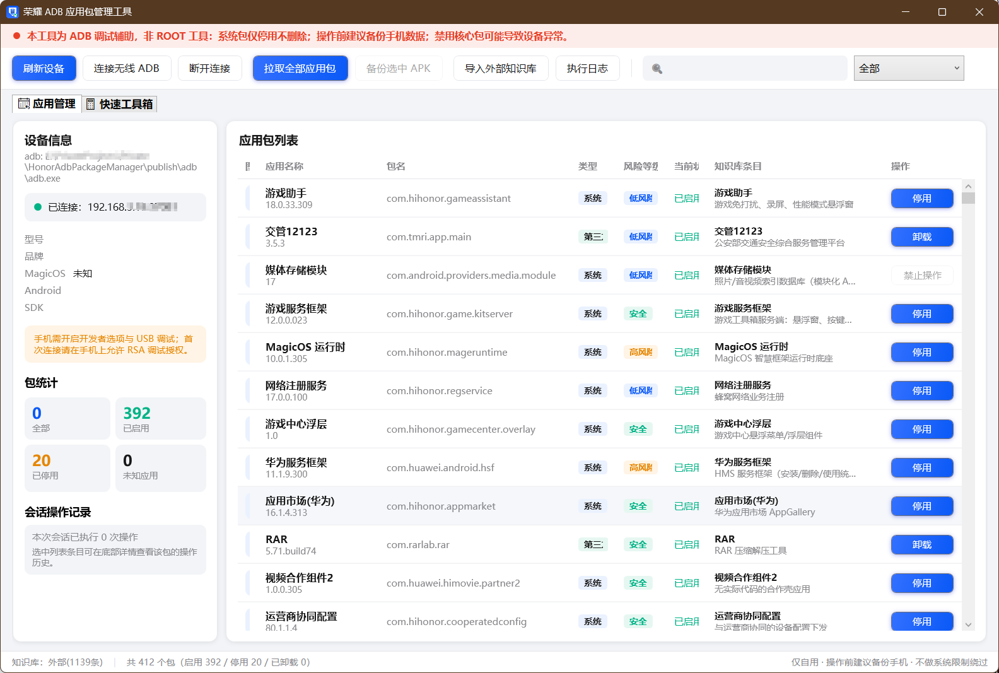
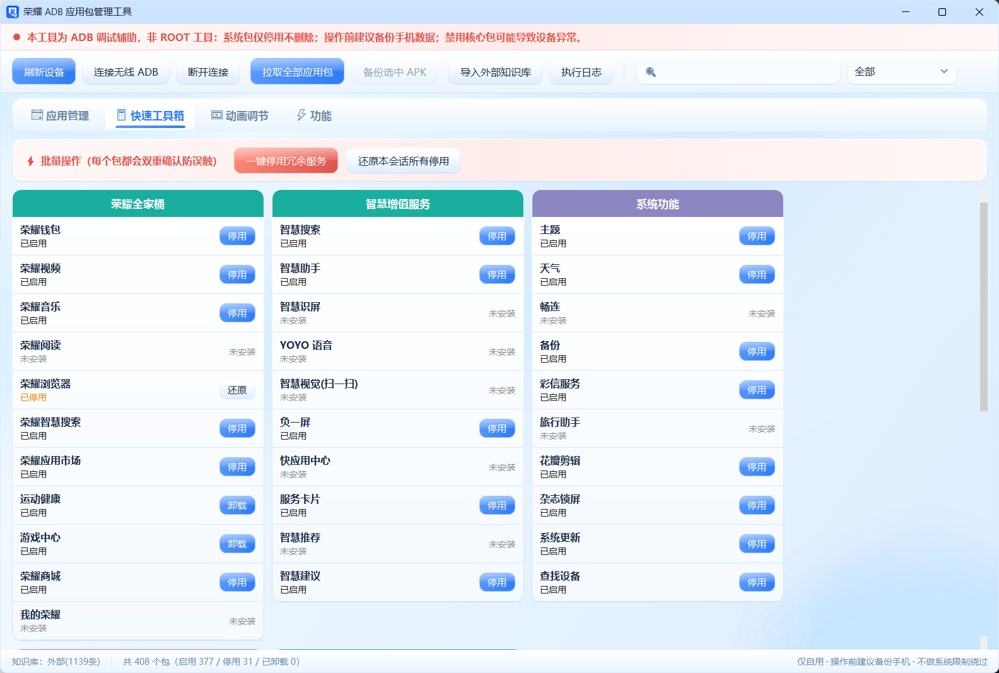
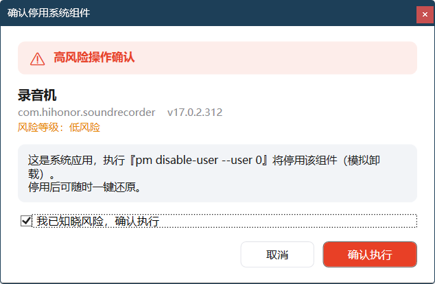

# HonorAdbPackageManager v1.4.0

**免 ROOT 管理荣耀 MagicOS 手机的应用包** —— 读取全部应用包名，自动匹配内置中文知识库（名称/功能/风险），系统包一键停用还原、第三方包卸载、核心组件智能拦截、APK 一键备份；内置仿鸿蒙工具箱的「快速工具箱」批量操作页；全新「动画调节 / 功能」快捷设置页：动画缩放、亮屏时间、刷新率范围、状态栏图标精简、开发者快捷开关，全部通过官方 `settings` 命令写入并自动回读校验。

[](#) [](#) [](#) [](#) [](#)

> ⚠️ 本工具为 ADB 调试辅助，**非 ROOT 工具**。系统包仅停用不删除；操作前建议备份手机数据。

---

## 📥 下载

| 文件 | 说明 |
| --- | --- |
| `HonorAdbPackageManager-v1.4.0.zip` (67.2 MB) | 自包含发行包：内置 .NET 10 运行时 + ADB 37.0.1 + 知识库 1139 条，**解压即用，目标机无需安装任何依赖** |

**SHA256**（对应本地构建文件 `HonorAdbPackageManager-v1.4.0-r14.zip`）：`1F4E1B7AA8C05BCB5882E6ED292370979B492CEA4AF07249643602C80386BAA6`

系统要求：Windows 10 (1709+) / Windows 11 x64。

---

## 🆕 v1.4.0 更新内容（v1.3.0 → v1.4.0）

### ⚙️ 快捷设置（全新「动画调节」+「功能」选项卡）

主界面选项卡由两个扩展为**四个**：**应用管理 / 快速工具箱 / 动画调节 / 功能**。后两个为本次新增的快捷设置页，与主界面共享设备连接——设备上线后自动读取各项当前值，无需手动刷新。

#### 「动画调节」选项卡

| 调节项 | 对应系统设置 | 说明 |
| --- | --- | --- |
| 窗口动画缩放 | `global window_animation_scale` | 界面小弹窗出现的过渡动画 |
| 过渡动画缩放 | `global transition_animation_scale` | 界面切换（Activity 跳转）的过渡动画 |
| 动画程序时长缩放 | `global animator_duration_scale` | 应用内动画时长（时钟指针、涟漪等） |

- 预设档位：**0（关闭）· 0.5 · 1（系统默认）· 1.5（推荐）· 2 · 5（慢动作）**，每项实时显示「当前系统值」
- 修改**立即生效，无需重启**；执行前弹窗列出全部将改动的参数

#### 「功能」选项卡

| 分区 | 内容 |
| --- | --- |
| 📱 设备信息 | 一键读取 Android 版本 / API / MagicOS 版本 / 安全补丁 / 机型 / 分辨率（`wm size`）/ 当前刷新率 |
| 🖥 屏幕与显示 | **亮屏时间**：5 ~ 600 分钟任意设置（自动换算毫秒写入，显示当前值；Android 原生上限约 30 分钟，更大值部分机型仍生效）。**刷新率范围**：30 ~ 165Hz 上下限——90/120 智能均衡 · 60/60 锁定省电 · 120/120 全程流畅 |
| 📊 状态栏图标精简 | NFC / 定位 / 省电模式 / 闹钟 / HD 高清通话 / 电池百分比 / 护眼模式 / 网速指示器 / 双卡信号，共 9 项开关（勾选 = 显示，取消 = 隐藏），一键还原默认显示 |
| ⚡ 开发者快捷开关 | 保持唤醒（充电时不息屏）/ 显示触摸操作 / 指针位置 / 严格模式，逐项确认执行；「USB 调试」为只读保护项，防止误关导致工具断连 |

#### 安全机制

- 全部修改通过官方 `adb shell settings put/get`（global / system 命名空间）完成，**不做任何绕过**
- **写入后自动回读校验**：读回值与写入值不一致即判定失败，提示「系统可能限制了该设置项」（如荣耀部分机型的刷新率由 MagicOS 智能调度接管）
- 每项操作前弹确认框，列出将执行的具体修改；修改写入系统设置数据库，**重启手机后仍保留**，可随时在本页或系统设置中恢复

### 🐛 关键修复

- **无线 ADB 无法连接**：修复无线连接链路。连接结果按 `adb connect` 回执文本（`connected` / `cannot connect`）如实判定——成功后**自动重新探测设备**进入主界面；失败时完整显示 adb 返回的失败原因与排查建议（IP:端口是否正确、手机与电脑是否同一 Wi-Fi、无线调试端口每次开启会变化需重新查看）。启动页「无线 ADB 模式」6 步指引 → 连接输入框（自动预填上次成功地址）→ 连接，全流程免数据线。

---

## 🧠 内置中文知识库（1139 条）

| 分类 | 条数 | 覆盖 |
| --- | --- | --- |
| 荣耀 hihonor | 351 | MagicOS 8/9/10/11 系统组件 + 智慧服务 |
| 华为遗留 huawei | 296 | 双品牌过渡机型（Magic5 Pro 等实测） |
| 荣耀旧前缀 honor | 68 | 旧版系统兼容 |
| AOSP 系统 + Google + 高通 | 171 | 系统框架 / APEX / GMS / 高通底层 |
| 第三方及其他 | 253 | 国内主流 + 国际 Top100 |

- **真机实测**：荣耀 Magic5 Pro（MagicOS 11）412 个包 **100% 匹配显示**
- 数据来源：UAD-NG 社区数据库、CSDN《MagicOS 内置应用注释》、荣耀社区公开资料，人工翻译整理
- 支持编辑 `Data\HonorPackageDb.json` 或界面导入外部 JSON 合并（同键覆盖）

---

## ✨ 功能总览

### 📦 应用包管理
- **全量包读取**：`pm list packages` 四路合并 + `dumpsys` 4 线程并发解析，400+ 包约 30 秒
- **三类包分级**：第三方应用（可卸载）/ 系统可停用包（disable-user）/ 核心系统包（禁止操作，按钮灰化）
- **停用 / 还原**：`pm disable-user` 数据保留，`pm enable` 一键还原
- **第三方包卸载**：`pm uninstall -k --user 0`
- **APK 备份**：`adb pull` 拉取到 `Backup\{设备序列号}\`
- **搜索 / 筛选 / 排序**：包名/名称/描述实时过滤 + 类型筛选 + 列头排序

### 🧰 快速工具箱
- 分类卡片（荣耀全家桶 / 智慧增值服务 / 系统功能 / 专项功能 / 冗余服务），条目按包名 + 备选包名自动探测绑定主列表
- 「一键停用冗余服务」批量操作 + 「还原本会话所有停用」，全部双重确认

### ⚙️ 快捷设置（v1.4.0 新增）
- 动画缩放调节（立即生效）、亮屏时间、刷新率范围、状态栏图标精简、开发者快捷开关
- 全部 `settings` 命令写入 + 回读校验 + 操作前确认 + 设备上线自动读取当前值

### 🛠️ 工具能力
- 实时 ADB 命令日志（stdout/stderr 全量，可导出 TXT）
- 无线 ADB（地址记忆 + 启动页引导）、多设备选择
- 高 DPI（PerMonitorV2）、自包含免安装、ADB 内置

---

## 📸 截图

| 主界面 | 快速工具箱 | 风险确认 |
| --- | --- | --- |
|  |  |  |

---

## 🚀 快速开始

1. 解压发行包到任意目录（免安装、无需 .NET）
2. 手机开启 USB 调试并连接，允许 RSA 授权；或点「无线 ADB 模式」按指引连接
3. 双击 `HonorAdbPackageManager.exe` → 【重新检测】→ 【进入主界面】
4. 【拉取全部应用包】→ 在「应用管理」或「快速工具箱」中操作，按提示双重确认
5. 需要调节系统体验时，切换到「动画调节」/「功能」选项卡

> 💡 推荐流程：**先备份 APK → 停用观察 1-2 天 → 无异常保持**。停用可随时一键还原。

---

## ⌨️ ADB 命令映射

| 界面操作 | 实际命令 | 可否恢复 |
| --- | --- | --- |
| 卸载（第三方） | `pm uninstall -k --user 0 <包名>` | 需原 APK 重装 |
| 停用（系统包） | `pm disable-user --user 0 <包名>` | ✅ `pm enable` |
| 还原启用 | `pm enable <包名>` | — |
| 备份 APK | `adb pull <apk路径>` | — |
| 动画缩放 | `settings put global <三项动画 scale> <值>` | ✅ 改回 1 即系统默认 |
| 亮屏时间 | `settings put system screen_off_timeout <毫秒>` | ✅ 本页或系统设置改回 |
| 刷新率范围 | `settings put system min_refresh_rate / peak_refresh_rate` | ✅ 本页或系统设置改回 |
| 状态栏图标 | `settings put global <icon_* 等> 0/1` | ✅ 「还原（默认显示）」一键恢复 |

荣耀新版 MagicOS 的 SPC 系统保护会拒绝部分系统包的停用请求，工具如实反馈失败原因，**不做任何绕过**。

---

## 🛠️ 从源码构建

```bash
git clone https://github.com/HaoDaYiGuoFan/HonorAdbPackageManager.git
cd HonorAdbPackageManager
dotnet publish HonorAdbPackageManager/HonorAdbPackageManager.csproj \
  -c Release -r win-x64 --self-contained true -o publish
```

技术栈：.NET 10 / WPF / MVVM / 全异步 ADB / PerMonitorV2 高 DPI

---

## ❓ FAQ

**Q：停用失败提示 Permission Denial？**
荣耀 SPC 系统保护，属正常限制，工具不绕过。

**Q：停用后想恢复？**
「应用管理」筛选「已停用」→ 点【还原启用】；或「快速工具箱」→【还原本会话所有停用】。

**Q：快捷设置里某项写入失败 / 不生效？**
部分设置项被 MagicOS 智能调度或系统安全策略接管（尤其刷新率）。工具写入后会回读校验，被系统忽略时如实提示失败，不做绕过。

**Q：快捷设置的修改重启后会丢吗？**
不会。写入的是系统 settings 数据库，重启保留；可随时在本页改回，或在手机系统设置中恢复。

**Q：动画缩放设为 0 有什么影响？**
界面过渡动画全部关闭，视觉上「秒开」但缺少过渡效果；随时可改回 1（系统默认）。

**Q：功能说明列显示「未收录」？**
该包未收录知识库，可编辑 `Data\HonorPackageDb.json` 补充（欢迎 PR）。

**Q：无线 ADB 连不上？**
v1.4.0 已修复无线连接问题。仍失败时请确认：手机与电脑同一 Wi-Fi、无线调试已开启、端口未变化（每次开启无线调试端口都会变，请重新查看后再连）。

**Q：支持其他品牌手机吗？**
支持任何开启 USB 调试的安卓设备；非荣耀/华为品牌的说明覆盖有限，欢迎提交机型数据。

---

## 📄 免责声明

本工具仅供个人学习与设备管理使用，免费、无广告、无追踪；不含 ROOT、解锁、绕过系统限制功能；操作系统应用前请自行备份数据，因使用本工具导致的数据丢失或设备异常由使用者自行承担。

---

**Full Changelog**: https://github.com/HaoDaYiGuoFan/HonorAdbPackageManager/commits/master
